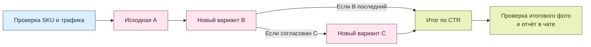

<p align="center">
  
</p>

<h1 align="center">Помощник OZON</h1>
<p align="center"><strong>А/Б-тест первой обложки в ChatGPT</strong></p>
<p align="center">
  <a href="https://chatgpt.com/plugins/Plugin_67b84f793f00819182b4aaa617f510cb">Открыть плагин в ChatGPT</a>
  ·
  <a href="skills/oz-ab-test-egi/SKILL.md">Посмотреть скилл</a>
</p>

Скилл сравнивает первые фото одного SKU в Ozon Seller. Обложки показываются покупателям по очереди. Исходная A и каждый новый вариант получают по одному интервалу сбора данных. Основная метрика — CTR перехода в карточку из воронки продаж. Рекламный CTR можно учитывать отдельно.

## Как проходит тест



1. **Подготовка.** Помощник сохраняет исходную обложку и смотрит трафик за три полных дня, чтобы оценить время первой проверки. Новые варианты можно приложить или попросить сгенерировать в ChatGPT. Перед публикацией их согласовывает пользователь.
2. **Один проход.** После команды на запуск помощник проверяет объём и длительность каждого интервала. При расчёте по уникальным посетителям учитываются завершённые полные дни, а день смены фото пропускается.
3. **Итог.** Когда последний вариант набрал объём и интервал готов к закрытию, сбор заканчивается даже при CTR ниже цели. Помощник проверяет, какое фото в итоге опубликовано, закрывает задачу и возвращает HTML-отчёт в исходном чате. Проверки идут в ходе работы в чате.

## Что написать в ChatGPT

В рабочем чате упомяните **@Помощник OZON** и попросите подготовить тест. Нужен авторизованный браузер с доступом к Ozon Seller.

> Подготовь А/Б-тест первой обложки для SKU 123456789 в моём кабинете Ozon Seller. Покажи оценку по трафику за три полных дня. Обложку B приложу. Параметры и запуск согласуем после подготовки.

Перед запуском укажите целевой CTR, минимальный объём на обложку, минимальную и предельную длительность интервала. Если нужен рекламный CTR, задайте его цель и объём рекламных показов. В конце можно оставить лидера или вернуть A.

## Что в репозитории

| Файл | Содержание |
| --- | --- |
| [SKILL.md](skills/oz-ab-test-egi/SKILL.md) | Основной сценарий для ChatGPT |
| [references/](skills/oz-ab-test-egi/references/) | Смена фото, учёт статистики и завершение теста |
| [workflow.py](skills/oz-ab-test-egi/scripts/workflow.py) | Журнал теста и расчёт следующего шага |
| [dashboard.py](skills/oz-ab-test-egi/scripts/dashboard.py) | Автономный HTML-отчёт с обложками, CTR, объёмами и журналом |

Проверка на искусственных данных. Требуется Python 3.10+ и Pillow.

```bash
python -m pip install -r skills/oz-ab-test-egi/scripts/requirements.txt
python -X utf8 skills/oz-ab-test-egi/scripts/self_test.py
```
