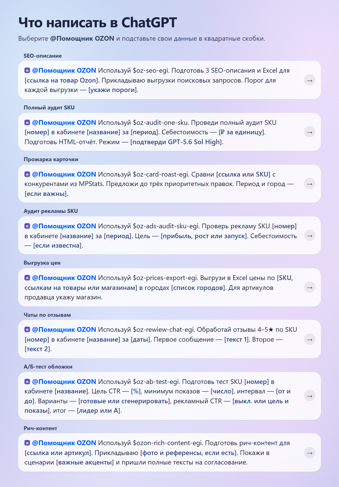
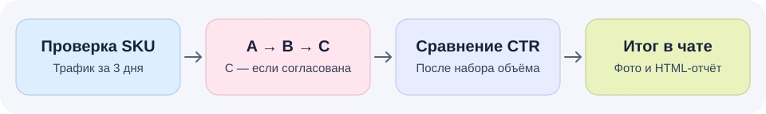
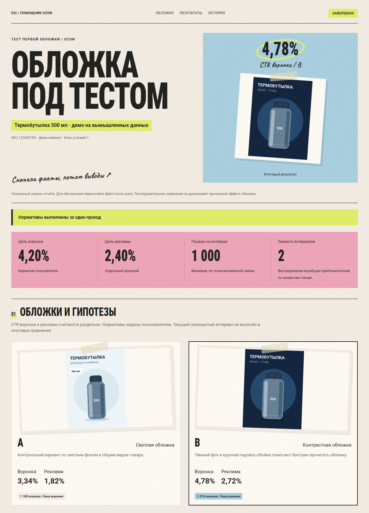

<p align="center">
  
</p>

<h1 align="center">Помощник OZON</h1>
<p align="center"><strong>Восемь навыков для работы с Ozon Seller в ChatGPT</strong></p>
<p align="center">
  <a href="https://github.com/EugeneSatt/HelperOZON/raw/refs/heads/main/downloads/oz-helper-egi-0.6.5.zip"><strong>Скачать плагин 0.6.5 · ZIP</strong></a>
  ·
  <a href="https://chatgpt.com/plugins/Plugin_67b84f793f00819182b4aaa617f510cb">Открыть плагин в ChatGPT</a>
  ·
  <a href="#навыки">Все навыки</a>
</p>

## Установка плагина

Скачайте ZIP по ссылке выше и загрузите его целиком в разделе «Плагины» в ChatGPT. Для импорта в рабочем пространстве нужна возможность загружать плагины. После установки выберите **@Помощник OZON** в рабочем чате и опишите задачу. Для работы с кабинетом понадобится авторизованный браузер с доступом к Ozon Seller.

## Навыки

| Навык | Что делает |
| --- | --- |
| [А/Б-тест обложки](skills/oz-ab-test-egi/SKILL.md) | Сравнивает первые фото одного SKU и готовит HTML-отчёт по CTR. |
| [Рич-контент](skills/ozon-rich-content-egi/SKILL.md) | Готовит сценарий на согласование, затем собирает и нарезает непрерывные ленты для телефона и компьютера. |
| [SEO-описание](skills/oz-seo-egi/SKILL.md) | Подбирает запросы из выгрузок Ozon и готовит три варианта описания и Excel. |
| [Прожарка карточки](skills/oz-card-roast-egi/SKILL.md) | Сравнивает карточку с конкурентами из MPStats и предлагает до трёх приоритетных улучшений. |
| [Полный аудит SKU](skills/oz-audit-one-sku/SKILL.md) | Проверяет контент, цены, акции, отзывы, наличие, рекламу и экономику товара. |
| [Аудит рекламы SKU](skills/oz-ads-audit-sku-egi/SKILL.md) | Разбирает рекламу товара по кампаниям и готовит HTML и Excel с расчётами. |
| [Выгрузка цен](skills/oz-prices-export-egi/SKILL.md) | Собирает в Excel цены Ozon по товарам, магазинам и городам. |
| [Чаты по отзывам](skills/oz-rewiew-chat-egi/SKILL.md) | По запросу отправляет предоставленные сообщения покупателям, оставившим отзывы на 4–5 звёзд. |

## Что написать в ChatGPT

Выберите **@Помощник OZON** и замените значения в квадратных скобках на свои. Название скилла после `$` подсказывает помощнику, какой сценарий использовать.



<details>
<summary>Примеры запросов для копирования</summary>

**SEO-описание**

> Используй $oz-seo-egi. Подготовь 3 SEO-описания и Excel для [ссылка на товар Ozon]. Прикладываю выгрузки поисковых запросов. Порог для каждой выгрузки — [укажи пороги].

**Полный аудит SKU**

> Используй $oz-audit-one-sku. Проведи полный аудит SKU [номер] в кабинете [название] за [период]. Себестоимость — [₽ за единицу]. Подготовь HTML-отчёт. Режим — [подтверди GPT-5.6 Sol High].

**Прожарка карточки**

> Используй $oz-card-roast-egi. Сравни [ссылка или SKU] с конкурентами из MPStats. Предложи до трёх приоритетных правок. Период и город — [если важны].

**Аудит рекламы SKU**

> Используй $oz-ads-audit-sku-egi. Проверь рекламу SKU [номер] в кабинете [название] за [период]. Цель — [прибыль, рост или запуск]. Себестоимость — [если известна].

**Выгрузка цен**

> Используй $oz-prices-export-egi. Выгрузи в Excel цены по [SKU, ссылкам на товары или магазинам] в городах [список городов]. Для артикулов продавца укажу магазин.

**Чаты по отзывам**

> Используй $oz-rewiew-chat-egi. Обработай отзывы 4–5★ по SKU [номер] в кабинете [название] за [даты]. Первое сообщение — [текст 1]. Второе — [текст 2].

**А/Б-тест обложки**

> Используй $oz-ab-test-egi. Подготовь тест SKU [номер] в кабинете [название]. Цель CTR — [%], минимум показов — [число], интервал — [от и до]. Варианты — [готовые или сгенерировать], рекламный CTR — [выкл. или цель и показы], итог — [лидер или A].

**Рич-контент**

> Используй $ozon-rich-content-egi. Подготовь рич-контент для [ссылка или артикул]. Прикладываю [фото и референсы, если есть]. Покажи в сценарии [важные акценты] и пришли полные тексты на согласование.

</details>

## Пример работы с А/Б-тестом

Скилл сравнивает первые фото одного SKU в Ozon Seller. Обложки показываются покупателям по очереди. Исходная A и каждый новый вариант получают по одному интервалу сбора данных. Основная метрика — CTR перехода в карточку из воронки продаж. Рекламный CTR можно учитывать отдельно.



1. **Подготовка.** Помощник сохраняет исходную обложку и смотрит трафик за три полных дня, чтобы оценить время первой проверки. Новые варианты можно приложить или попросить сгенерировать в ChatGPT. Перед публикацией их согласовывает пользователь.
2. **Один проход.** После команды на запуск помощник проверяет объём и длительность каждого интервала. При расчёте по уникальным посетителям учитываются завершённые полные дни, а день смены фото пропускается.
3. **Итог.** Когда последний вариант набрал объём и интервал готов к закрытию, сбор заканчивается даже при CTR ниже цели. Помощник проверяет, какое фото в итоге опубликовано, закрывает задачу и возвращает HTML-отчёт в исходном чате. Проверки идут в ходе работы в чате.

### Пример HTML-отчёта

Демо на вымышленных данных. У светлой обложки A CTR воронки **3,34%**, у контрастной B — **4,78%** при цели **4,20%**. На снимке видны итог, обе обложки, объём показов и отдельный CTR рекламы.



Если учитываете рекламный CTR, укажите его цель и минимальный объём рекламных показов отдельно. При генерации обложек согласуйте количество вариантов и лимит попыток.

## Как проверяются обновления

Первый шаг после нового вызова А/Б-теста через `@` — сравнить [номер версии скилла на GitHub](skills/oz-ab-test-egi/VERSION) с установленным. Если версия новее, помощник покажет оба номера и предложит скачать отдельную копию или остаться на текущей. Подключённый плагин и локальные правки сохраняются. Уже запущенный тест продолжается на своей версии.

## Что в репозитории

| Файл | Содержание |
| --- | --- |
| [plugin.json](plugin.json) | Описание, версия и оформление плагина |
| [.codex-plugin/plugin.json](.codex-plugin/plugin.json) | Манифест совместимости Codex |
| [skills/](skills/) | Все восемь навыков с инструкциями, скриптами и шаблонами |
| [downloads/](downloads/) | Полный ZIP для импорта в ChatGPT |

Проверка А/Б-скилла на искусственных данных. Требуется Python 3.10+ и Pillow.

```bash
python -m pip install -r skills/oz-ab-test-egi/scripts/requirements.txt
python -X utf8 skills/oz-ab-test-egi/scripts/self_test.py
```
